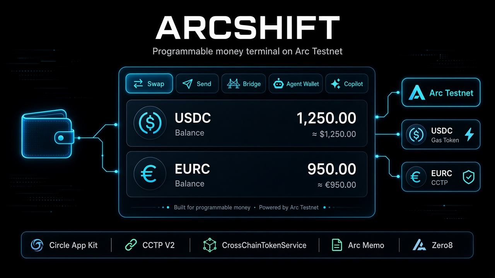
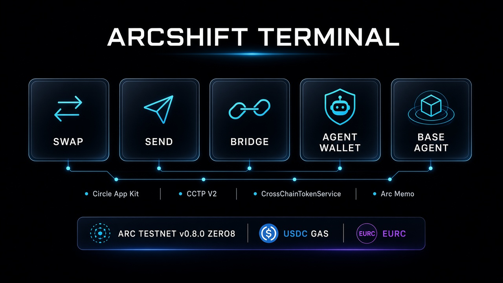
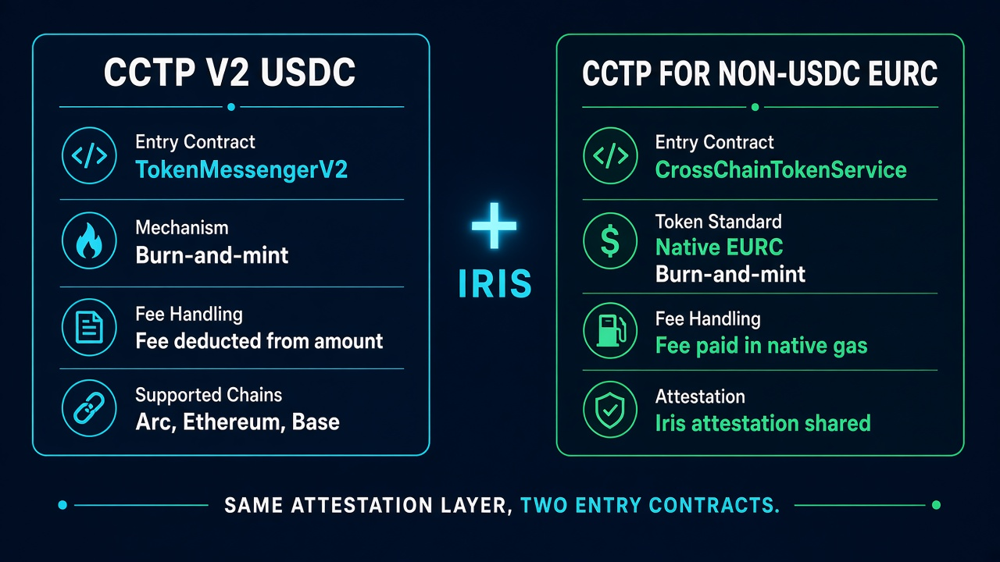
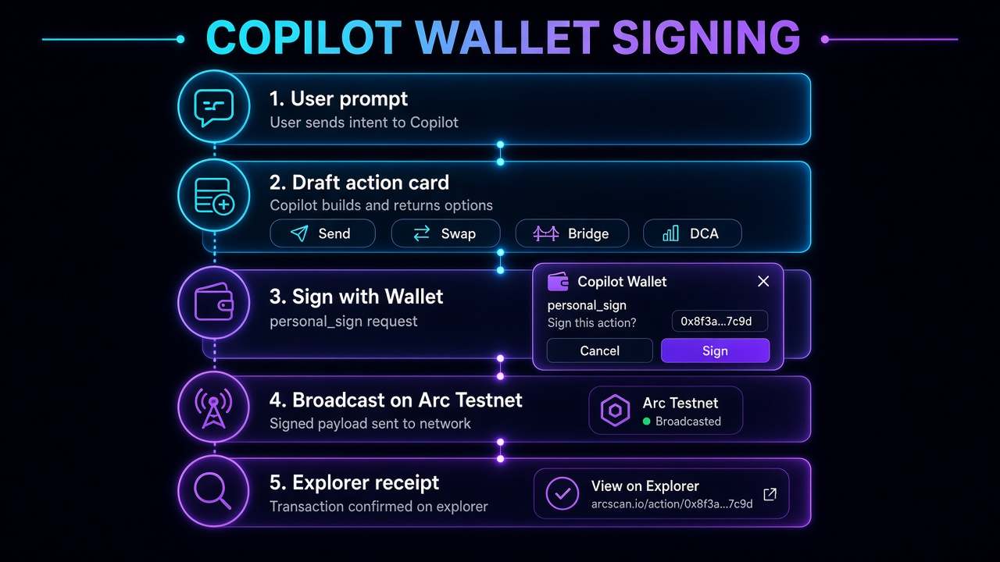
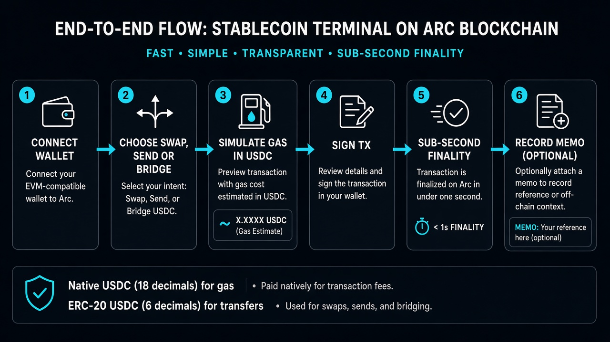
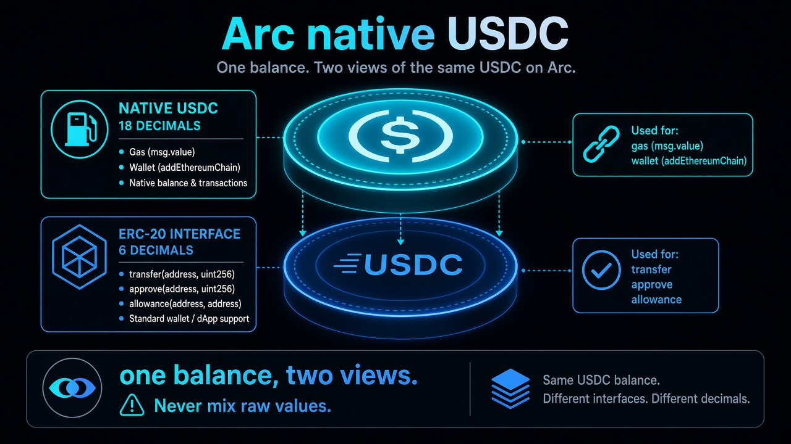
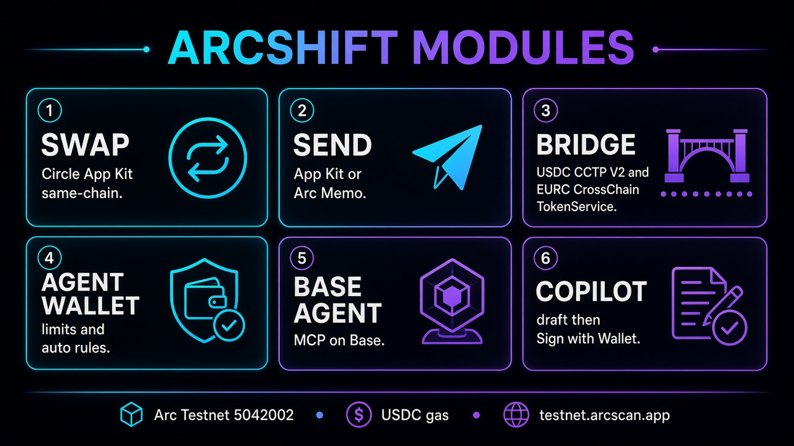

# The journey of building ArcShift: a programmable-money terminal on Arc Testnet

Edited at September 14, 2026

**Agentic Economy**

Hello Arc house,

Following Circle’s write-up on [CCTP extending the crosschain trust layer to EURC](https://www.circle.com/blog/cctp-extends-circles-crosschain-trust-layer-to-eurc), and the [Arc Testnet v0.8.0 (Zero8) hardfork](https://community.arc.io/home/blogs/arc-testnet-v080-hardfork-2026-08-28), I want to introduce **ArcShift** in more depth. This is a terminal for swapping, sending, and bridging Circle stablecoins on Arc — with an AI copilot that drafts the job and requires a wallet signature before anything is broadcast.

The goal of this article is to help developers already familiar with Arc and Circle’s stack understand why ArcShift was designed this way and how the core flows actually work. You can read the source at [https://github.com/nhattung99/arcshift](https://github.com/nhattung99/arcshift) and experience it directly at [https://arcshiftcircle.vercel.app/](https://arcshiftcircle.vercel.app/).

ArcShift’s design focuses on **correct Arc semantics first**: USDC as gas, two decimal views of the same native balance, native EURC via CCTP for non-USDC, and payment references through the predeployed Memo contract. The point is not to wrap Arc as “another ETH L1”, but to sit on the primitives the chain actually ships.



---

## 1. What is ArcShift?

ArcShift is a Web3 terminal for programmable money on Arc Testnet. Users connect a wallet (or stay in sandbox) and can:

- **Swap:** USDC, EURC, USYC, and cirBTC on Arc through Circle App Kit.
- **Send:** wallet-to-wallet transfers, optionally attaching an on-chain **transaction memo**.
- **Bridge:** USDC with CCTP V2 (`TokenMessengerV2`) and EURC with CCTP for non-USDC (`CrossChainTokenService`).
- **Agent Wallet:** deposit USDC, set a daily limit, and attach automated swap / bridge rules.
- **Base Agent:** natural-language send / swap on Base via MCP.
- **Copilot:** draft DCA, swap, send, bridge, or rebalance from a prompt, then **Sign with Wallet**.

A typical request looks like: *“Track nothing — just move money. Bridge 20 EURC from Arc Testnet to Base Sepolia.”* The terminal drafts the CCTP burn, asks for `personal_sign`, then (in live mode) approves the TokenManager and calls `crossChainTransfer`.

The core point is **wallet-gated agency**: user funds never leave the EOA into a platform hot wallet. The copilot proposes; the wallet authorizes; Arc finalizes in under a second.



---

## 2. Four core layers

To realize this, ArcShift is built on four layers — App Kit for the dollar rail, CCTP for native crosschain, Memo for payment references, and Copilot for agentic drafting.

### Circle App Kit — Swap, Send, USDC Bridge

This is the Commerce surface. App Kit wraps same-chain swaps, simple sends, and CCTP for **USDC**, so we do not re-implement burn / attestation / mint by hand for the dollar rail.

**Logic:**

- `kit.swap({ tokenIn, tokenOut, amountIn })` on Arc Testnet (USDC, EURC, cirBTC).
- `kit.send({ token, to, amount })` for wallet-to-wallet.
- `kit.bridge({ token: 'USDC' })` for native USDC CCTP.

USDC behavior is unchanged. App Kit Bridge is **USDC-only**. EURC does not go through that path. That is a product constraint we encoded instead of fighting.

### CCTP V2 + CCTP for non-USDC (EURC)

This is the Crosschain layer.

**Problem solved:** How do we move both USDC and EURC natively, without pool-based bridges?

| Feature | CCTP (USDC) | CCTP for non-USDC (EURC) |
| --- | --- | --- |
| Token | USDC | EURC (pre-registered) |
| Entry contract | `TokenMessengerV2` | `CrossChainTokenService` |
| Fee | Deducted from the transferred amount | Paid in **native gas** on the source chain |
| Attestation | Iris | Iris (shared) |
| Testnet domains | 0 / 6 / 26 | Ethereum Sepolia, Base Sepolia, Arc Testnet |

EURC flow (sandbox):

1. `resolveTokenManager` + `resolveTokenAddress` on `CrossChainTokenService` (`0x63753E722bd2C2A5DF6EE19C5106662208B81077`).
2. Approve the **per-token TokenManager** (not CCTS itself).
3. Quote fees from Iris (`PRE_FINALITY` + optional `FORWARD`). Fall back to standard finality if fast transfer is not configured for that FX pair.
4. `crossChainTransfer(tokenId, amount, destinationDomain, packedRecipient, …)` with `value = feeTotalAmount`.



Why two entry contracts?

Because USDC and EURC do not share the same messenger. Pretending they do would produce a “bridge” button that silently fails for euros. ArcShift makes the split explicit: same Iris attestation layer, two burn paths.

### Arc Memo — structured payment references

**Problem solved:** How do we attach an invoice ID to a USDC transfer without breaking ERC-20 calldata?

Appending hex to `transfer()` calldata is not a memo. On Arc, memos go through the predeployed contract:

- Memo: `0x5294E9927c3306DcBaDb03fe70b92e01cCede505`
- The inner call routes through **CallFrom**, so `msg.sender` stays the user’s EOA.
- `memo(target, data, memoId, memoData)` wraps `USDC.transfer` (6-decimal ERC-20 view).
- Gas estimation on this path often reverts; we set an explicit gas limit (`300000`).

This is the equivalent of “payment reference” in traditional rails — except it is on-chain and queryable.

### Copilot + wallet signing — the agent surface

**Problem solved:** How can an AI propose a job without holding keys?

1. User picks a prompt (swap, send, bridge, DCA, rebalance).
2. Copilot renders an action card with exact parameters.
3. **Sign with Wallet** → `personal_sign` of an authorization message (`ArcShift Agent Authorization` + action fields).
4. Only after a valid signature do we call App Kit / CCTP-X / Memo.
5. User reject (`4001`) stays on the card as “Signature rejected”. No silent confirm.

No private keys in the backend. The model drafts; the EOA signs. That is the trust model.



---

## 3. End-to-end flow

This is an overview of the entire ArcShift workflow from start to finish, combining the Commerce layer (App Kit / CCTP) and the Agent layer (Copilot):

```
User opens ArcShift
       ↓
Connect wallet  or  Sandbox
       ↓
Choose Swap / Send / Bridge  or  Copilot prompt
       ↓
[Arc semantics] Reserve native USDC for gas (18 decimals)
       ↓
[Sign] personal_sign  (Copilot)  or  tx signature  (terminal)
       ↓
[App Kit] swap / send / USDC bridge
   or
[CCTP-X] EURC CrossChainTokenService
   or
[Memo] memo() wrapping ERC-20 transfer
       ↓
Sub-second finality on Arc  →  explorer on testnet.arcscan.app
```



**Actual time (estimated, testnet):**

- Wallet switch / add Arc (native USDC, **18 decimals**): ~5–15 seconds
- Same-chain swap or send: sub-second inclusion
- USDC CCTP Fast Transfer: ~8–20 seconds
- EURC CCTP-X (fast + forward): ~8–20 seconds; standard ~15 minutes if Iris has no FX symbol
- Memo send: one transaction through the Memo contract
- Copilot sign: one `personal_sign`, then the on-chain tx above

---

## 4. Notable design features

Some details that matter more on Arc than on a generic EVM fork:

**One USDC, two decimal views**

Native USDC (`msg.value`, gas, `getBalance`) uses **18 decimals**. The ERC-20 interface at `0x3600000000000000000000000000000000000000` uses **6 decimals**. They are the same asset. `wallet_addEthereumChain` must advertise `decimals: 18` or MetaMask will display balances ~10¹² too large. We never mix raw units.



**Zero8 RPC error surface (v0.8.0)**

After reth 2.2 / revm 38, insufficient-balance `eth_call` / `eth_estimateGas` no longer always say `insufficient funds for gas * price + value`. Tooling must also match `OutOfFunds` and `gas required exceeds allowance`. No consensus change — only the JSON-RPC text. ArcShift matches both.

**USDC as gas token**

Arc Testnet uses USDC instead of ETH as the native gas token. This requires a custom chain definition in viem / `wallet_addEthereumChain` because the default EVM config uses the ETH symbol, which breaks wallet gas estimation.

**Iris proxy**

Browser calls to `iris-api-sandbox.circle.com` are proxied through `/api/iris/*` so CCTP-X quotes do not die on CORS.

**Sandbox vs live**

Without a wallet, ArcShift simulates routes (including EURC burn-and-mint steps) so builders can demo the UX. With `window.ethereum`, Copilot uses real `personal_sign` and live App Kit / CCTP-X.

**Gas tank checks**

On Arc, swapping or bridging the entire USDC balance leaves nothing for gas. The terminal reserves a small native USDC buffer before submit.

**Full-flow retries**

CCTP-X quotes try fast transfer first, then fall back to standard finality. Gas-insufficient errors are matched against the Zero8 text, not only the pre-v0.8.0 string.

---

## 5. Modules available today



| Surface | What it does |
| --- | --- |
| Swap | App Kit same-chain swap (USDC / EURC / cirBTC on Arc Testnet) |
| Send | App Kit send, or Memo-wrapped ERC-20 transfer on Arc |
| Bridge | USDC: App Kit CCTP. EURC: CrossChainTokenService + Iris |
| Agent Wallet | Funding, daily limit, auto-swap / auto-bridge rules |
| Base Agent | MCP tools: wallets, portfolio, send, swap, request status |
| Copilot | Draft + **Sign with Wallet** for DCA, rebalance, send, swap, bridge |

Supported test rails: Arc Testnet, Ethereum Sepolia, Base Sepolia (and Base Mainnet for USDC where App Kit allows).

---

## 6. Chain and infrastructure

- **Chain:** Arc Testnet (chain ID `5042002`)
- **Gas token:** USDC (native 18 decimals; ERC-20 view 6)
- **Explorer:** [testnet.arcscan.app](https://testnet.arcscan.app)
- **Faucet:** [faucet.circle.com](https://faucet.circle.com)
- **SDKs:** `@circle-fin/app-kit`, `@circle-fin/adapter-viem-v2`, viem
- **CCTP-X:** `CrossChainTokenService` at `0x63753E722bd2C2A5DF6EE19C5106662208B81077` (CREATE3, same on Sepolia / Base Sepolia / Arc)
- **Memo:** `0x5294E9927c3306DcBaDb03fe70b92e01cCede505`
- **AI:** Copilot drafts action cards locally for canned prompts; free-form chat can call a model API
- **Frontend:** Next.js App Router
- **Wallet:** injected EOA (`window.ethereum`)
- **Live dapp:** [https://arcshiftcircle.vercel.app/](https://arcshiftcircle.vercel.app/)

Node operators should be on **arc-node v0.8.0** (Zero8 activated 2026-09-03 15:00 UTC). See [BREAKING_CHANGES.md](https://github.com/circlefin/arc-node/blob/main/BREAKING_CHANGES.md).

---

## 7. Future development

We are continuing to develop ArcShift. Honest gaps:

- **Agent Wallet custody:** the UX for funding, limits, and auto-rules is in place; wiring full Circle Developer-Controlled Wallets is next.
- **EURC CCTP:** production routes start with Ethereum and Base; Arc Testnet is on the non-USDC domain list, but Iris fast-transfer FX must be configured or we fall back to standard finality.
- **Copilot auth:** grow from `personal_sign` to EIP-712 typed data bound to chain ID and nonce.
- **Bridge recovery:** attestation timeout / refund UI, similar to App Kit error recovery — not yet a first-class flow.
- **Multi-provider agents:** Base Agent today talks to one MCP surface; the roadmap is multiple skill providers, closer to an open agent marketplace.
- **Privacy (APS):** on Arc’s chain roadmap, not in this terminal yet.

---

We hope this article has given a concrete overview of ArcShift and how it sits on Arc’s actual primitives — native USDC gas, Memo, CCTP, and CCTP for EURC — instead of pretending Arc is a generic EVM clone. We look forward to feedback and discussion from the house. Let’s keep building programmable money in the open.

Sincerely,  
**@nhattung00**  
Founder of ArcShift
